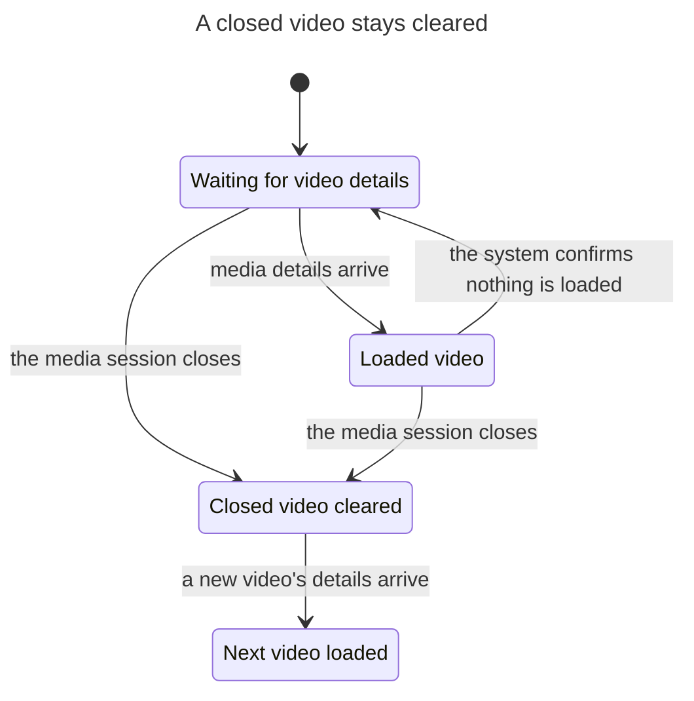
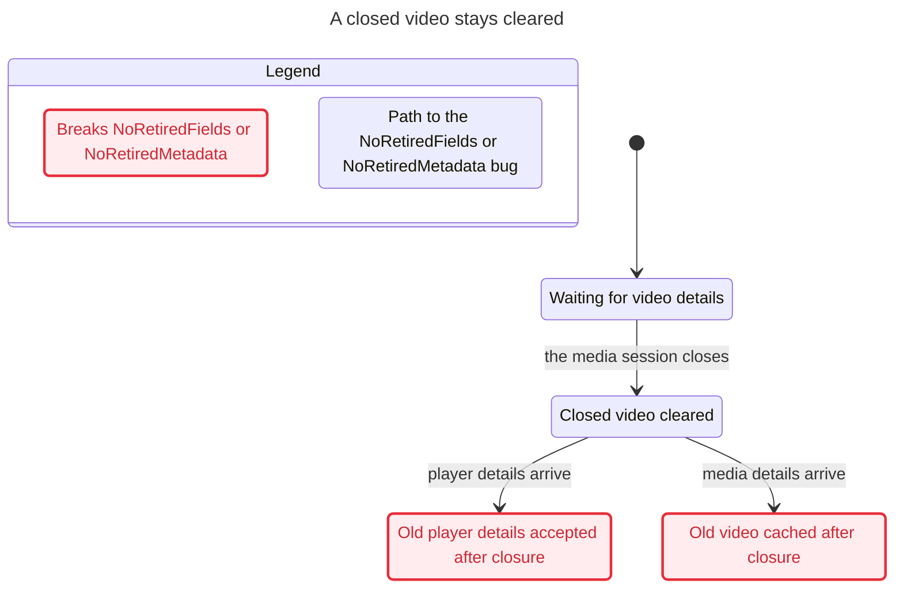
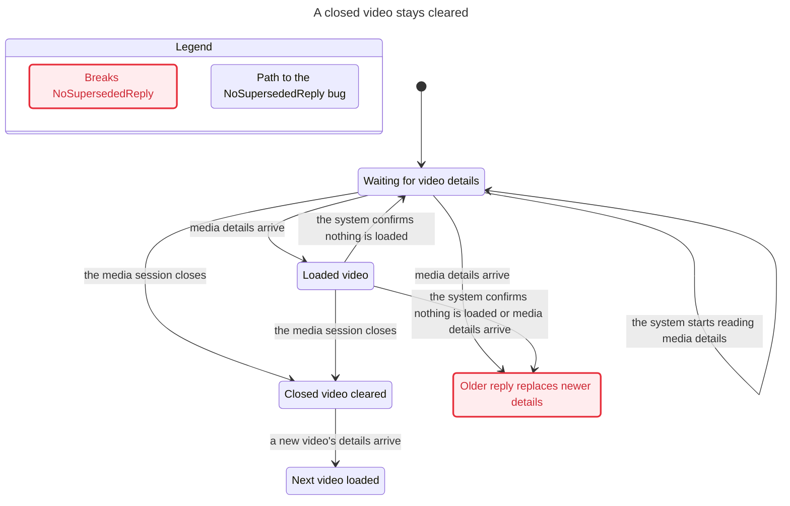

# Browser media-session review

No additional defect found within the checked scope. Product source remains unchanged from `b1bbc4d5c756998dd6ffa56f5e6d77efdb2d9803`.

TLC 1.7.4 exhaustively checked 312 reachable states and 1,388 transitions: one retirement, two total metadata reads, three independent startup field callbacks, empty or loaded metadata, and every allowed reply order. All three invariants and deadlock checking pass. Five independent guard-removal mutations in actual Objective-C source are caught by the native replay tests. The generated verification skill was followed end to end after writing it.

Rules:
- `NoRetiredMetadata`: a closed session cannot put its video back in the cache.
- `NoRetiredFields`: a closed session cannot put its old player identity or state back in the cache.
- `NoSupersededReply`: an earlier metadata read cannot overwrite a later read.

These are cache-acceptance properties. A partial cache need not be published until its mandatory fields are present. Native replays observe accepted conversions and callback emissions as well as the final payload.

The passing chart hides idle and same-label transitions. The session-guard mutant exceeds 500 states, so that chart shows shortest bug paths only. These mutant failures demonstrate test sensitivity; they are not bugs in the current code.

## Counterexamples and actual-code replay

- No session guard / `NoRetiredMetadata`: 0. startup reads pending; 1. the media session closes; 2. the old metadata reply arrives and is cached. The retired-startup native scenario sends a no-process playback notification, then invokes the held metadata callback. Removing its session comparison accepts the old metadata; current code rejects it.
- No session guard / `NoRetiredFields`: 0. startup reads pending; 1. the media session closes; 2. an old player-field reply arrives and is accepted. The same scenario invokes the held PID, playback, and parent callbacks separately. Removing each guard makes its named replay assertion fail; current code rejects all three.
- No request guard / `NoSupersededReply`: 0. the initial read is pending; 1. the system starts a newer read; 2. the earlier reply arrives before the newer one and is accepted. The retired-startup native scenario holds both reads and invokes the superseded callback while the latest remains pending. Removing the request comparison accepts the old reply; current code rejects it. The ordinary scenario additionally tests it after the newer reply has already been shown.

## Scope limits

The model assumes one serial callback queue and truthful response snapshots that may be delayed. It does not prove notification delivery by browsers/macOS, eventual clearing when no event arrives, response freshness inside MediaRemote, rendering, memory/CPU, artwork, debounce, enabled-command callbacks, counter overflow, fallback, helper recovery, arbitrary repeated retirements, or the full application-refresh path. Pause retention and app/queue event wiring are native regression coverage. The maintainer separately confirmed the installed app clears a closed video tab.

## Rerun

Set `JAVA` to a Java binary and `TLA2TOOLS` to the pinned official TLC 1.7.4 jar, then run `./scripts/verify-media-session.sh` from the project root. Read the generated project skill for exact setup, source correspondence, and `/statechart` interpretation. Model output and source mutations use fresh temporary directories; no product edits or app launch occur.

For charts, copy `MediaSession.tla`, its configs, and `view.mjs` into a fresh system temp directory. Use the installed `/statechart` skill, with that spec, config `MediaSession.cfg`, view `view.mjs`, and a new `--out` folder. Repeat with `NoSessionGuard.cfg` and `NoRequestGuard.cfg`. This keeps the invocation aligned with the installed skill. For later source changes, use `/maintain-formal-verification-skill` if available and update the sync record only after a correspondence review.

## Current code: all rules hold

# MediaSession

TLC reached 312 states and 1388 steps. The chart draws 4 states and 5 arrows.
The chart does not draw 868 steps that stay in one chart state.
The view hides 312 steps, so the chart does not draw them.

## Rules that hold
NoRetiredMetadata, NoRetiredFields, NoSupersededReply, NoDeadlock

## Deliberately broken: session guard removed

# MediaSession

TLC reached 873 states, more than the chart budget of 500, so the chart draws only the bug paths: 4 states and 3 arrows.

## NoRetiredMetadata breaks
The shortest path has 2 steps:
0. Waiting for video details
1. the media session closes: Closed video cleared
2. media details arrive: Old video cached after closure

## NoRetiredFields breaks
The shortest path has 2 steps:
0. Waiting for video details
1. the media session closes: Closed video cleared
2. player details arrive: Old player details accepted after closure

## Rules that hold
NoSupersededReply, NoDeadlock

## Deliberately broken: request guard removed

# MediaSession

TLC reached 384 states and 1664 steps. The chart draws 5 states and 8 arrows.
The chart does not draw 1007 steps that stay in one chart state.
The view hides 384 steps, so the chart does not draw them.

## NoSupersededReply breaks
The shortest path has 2 steps:
0. Waiting for video details
1. the system starts reading media details: Waiting for video details
2. media details arrive: Older reply replaces newer details

## Rules that hold
NoRetiredMetadata, NoRetiredFields, NoDeadlock

